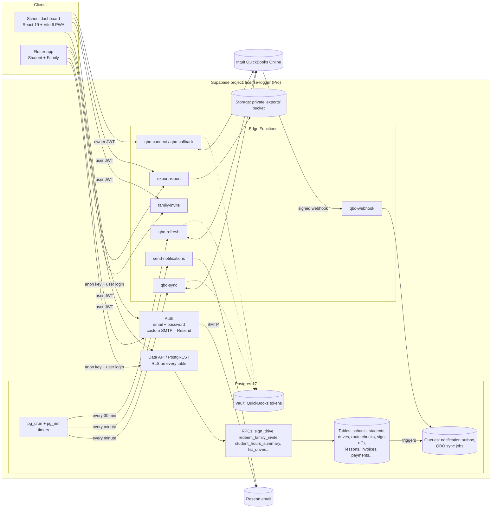

# LicenseLogger backend: launch plan (plain-language)

This folder is the whole LicenseLogger backend as files. **Nothing in it has been applied to your live Supabase project.** Your live project (`license-logger`, ref `nqfjudwncistygsmcgrq`, us-east-2) was only *read* to make sure this fits on top of it.

---

## 1. What this backend does, in one minute

- **Schools** use the web dashboard (React PWA). Staff see their students, schedules, sign-off queue, billing and QuickBooks status.
- **Students** use the Flutter app to log practice drives with GPS. When a drive ends, a supervisor signs it: initials on the student's phone, or from their own Family account.
- **Students don't need a school.** A parent-taught teen or an independent permit driver can sign up in the app, log drives, see hours for the state they pick, link family and export. They can join a school later and keep all their history, and they can leave again. See section 2b.
- **Family accounts** link to one or more students with an invite code like `LL-7Q4K-M2`.
- **Signed drives are locked.** Once signed, nobody can change the time, minutes, miles, route or supervisor. The database enforces this, not just the app.
- **Hours** follow each state's rules, which are stored as data for **all 50 states + DC**, from verified official sources (section 2c). For example, Texas: 30 h total, 10 h at night, and at most 2 h per day counts. Hawaii is marked unconfirmed.
- **QuickBooks Online.** A school connects its QuickBooks once. The login tokens go into Supabase Vault, which is encrypted. After that, invoices, payments and customers sync on their own. Retries never create duplicates.
- **Emails** (sign-off reminders, family invites) go out through Resend, and a retry never sends the same email twice.
- **Exports.** You can export an hours report or a single drive as a PDF or CSV. The file sits in a private bucket and is shared through a link that expires after 10 minutes.

## 2. Architecture

**Simple rules the design follows:**
- The apps only ever hold the public *anon* key and the logged-in user's token. The powerful *service_role* key lives only inside Edge Functions as an environment secret.
- Every table has Row Level Security (RLS) switched on and *forced*. A user only sees rows for their own school, their own student profile, or students they're linked to as family.
- Anything sensitive, such as signing, redeeming codes or connecting QuickBooks, goes through a database function (RPC). Each one checks permissions itself.
- Slow or outside work (email, QuickBooks) never runs while the user waits. It goes into a queue table, and a worker picks it up every minute and retries with backoff.

## 2b. Students without a school (independent / parent-taught)

**How it works:** a student row's `school_id` can now be empty, and empty means "independent".
- **Why this approach:** every school-side rule already asks "is this row in one of my schools?", and an empty school never matches. So staff can't see independent students, and no new policy logic was needed for that. Students and families already reach their own data through their account and family links, which don't depend on a school.
- **Alternative rejected: auto-created "personal school".** It would show up in the dashboard, billing and QuickBooks and would need filtering everywhere. It would also make each student the "owner" of a fake school, which gives them staff powers they shouldn't have.
- **Effect on live:** this is the only change to an existing live object. It only relaxes a rule. Nothing is dropped or renamed, and no existing row changes. The read-only check showed `postgres` owns the table and nothing else depends on the column.

**What an independent student can do:**
- log drives, with GPS chunks
- get hours against the state they choose (`update_my_student`)
- invite family with a code
- get supervisor sign-off on the phone or from the family app
- export a PDF/CSV, which says "Independent (practising with family)" where the school name goes

**What an independent student can't do:** school lessons, instructor sign-off, or billing/QuickBooks. The database refuses those.

**Joining a school later.** It's the same profile, so all history stays.
1. *The school gave the student a code* (the normal roster code from "Add student"). The app's `claim_student_profile` sees that the student already has an independent profile and asks: "Bring your drive history to Green Light?" Then `join_school_with_code` merges the school's roster entry (contacts, package, checklist, lessons, invoices) **into** the student's profile and deletes the empty roster entry.
2. *The school types the student's LicenseLogger code* (shown in the app). `request_student_link` creates a request. The school sees **nothing** until the student or a family member taps Accept (`respond_school_request`).

Accepting means the school sees the full drive history while the student is enrolled. The app says so on the consent screen.

**Leaving.** The student or family uses `leave_school`, or the school uses `release_student`. Either way the profile becomes independent again, and the student keeps every drive. The former school keeps only what it created and was responsible for:
- its lessons, where future bookings are cancelled
- its packages and invoices
- the drives that were *signed while enrolled*

It loses the roster entry, routes, family links, hours and every drive logged before or after enrollment. The `school_enrollments` table keeps the history and a name snapshot, so the dashboard can still label a former student.

**Two smaller points:**
- A parent can set up the profile first (`create_independent_student(..., p_for => 'family')`). The teen claims it later with the profile's join code.
- Billing rows can only point to a student who is currently at that school. QuickBooks sync can still update old invoices after the student leaves.

## 2c. State rules: all 51 jurisdictions

**What it is.** Every state plus DC now has its real rule, taken from the verified research in `state-driving-logs/` (official sources, checked Oct 22, 2026). The full contract for the apps is in `docs/STATE_RULES_SCHEMA.md`.

**What a rule can say:**
- total hours, night hours, and bad-weather hours (PA 5 h, SD 10 h; AK 10 h of "night or bad weather")
- caps: Texas counts at most 2 h a day, North Carolina at most 10 h a week
- instructor lessons: whether they count, a multiplier and a cap (Wisconsin: each instructor hour counts double, up to 5 instructor hours; Colorado up to 6 h)
- stages (Iowa: 20 h before the intermediate license, then 10 more; Michigan: 30 h before Segment 2, out of 50)
- alternative totals the family chooses (Oregon 100 h, or 50 h with approved driver ed; also AL, AZ, MA, MD, MN)
- logging in minutes (Minnesota, Nevada)
- supervisor age and years licensed (Texas 21+ with 1 year; New Hampshire 25+, but licensed parents are exempt)
- paperwork: whether it must be notarized (AZ FL OH OK RI SD; IL and AK only if the parent can't come), whether an app/printed log is accepted (NC MT MI NM NH; Nevada only its own form or RoadReady; Ohio's form or RoadReady Ohio), and the official form's name, number, PDF and links

**How a student's rule is picked:** by their state and their **permit issue date**. New Jersey has a new rule for permits from Feb 1, 2025, and Wisconsin for permits from Jul 11, 2021, so older permits get the older version. If the permit date is missing, today's rule is used. A school can still pin a specific rule.

**Honesty rules in the data:**
- Hawaii is marked **unconfirmed**: its hours aren't on an official state page, so no numbers were entered.
- Arkansas and Mississippi have no hours requirement.
- Anything the research couldn't confirm is `null` with a note in `field_status`, never a made-up number. Examples: night hours where a state doesn't say; New Jersey before 2025; Wisconsin's older night rule.
- Virginia's change for Jan 1, 2027 is shown as a heads-up but not built in yet.

**What the apps get:**
- `student_rule_progress`: each requirement, what's credited, what's waiting for a signature, and plain sentences like "20 h 36 m more in total"
- `state_resources` / `my_rule_resources`: a summary, a numbered checklist, the form details and links
- `set_rule_alternative` and `set_rule_milestone`
- Drives can now record bad-weather minutes, and supervisors can record a birth date and license date. If those dates are known and too young or too recent for the state, the sign-off is refused.
- The PDF export follows the state: minutes for MN/NV, a weather column where it counts, caps, stages, the official form's name and number, and a notary block where the state needs one.

**To change the data later:** edit the CSV mapping in `scripts/build_state_rules_seed.py`. Then generate a **new** migration with the output (don't edit 015 once it's pushed).

## 3. What's in the folder

| Path | What it is |
|---|---|
| `supabase/migrations/` | 15 numbered SQL files. The **first 4 are exact copies of what's live today**. The next 11 are new and only *add* things; they never drop or rename. The one change to a live object is making `students.school_id` optional. |
| `supabase/seed.sql` | Fake demo data for local/staging only: 2 schools, students, family, drives, an invoice. **Never run it on production.** |
| `supabase/functions/` | 8 Edge Functions plus shared helpers. |
| `supabase/tests/database/` | 8 pgTAP test files (444 checks). |
| `docs/STATE_RULES_SCHEMA.md` | The state-rules contract the Flutter app and dashboard mirror. |
| `scripts/build_state_rules_seed.py` | Turns the state research CSV into migration 015. |
| `supabase/manual/cron_schedules.sql` | Run once per project after deploy. Turns on the timers. |
| `supabase/manual/preflight_readonly.sql` | Read-only checks to run against live before pushing. |
| `supabase/config.toml` | Local dev settings (auth, storage, function JWT rules). |
| `scripts/test-local-no-docker.sh` | Runs everything on a plain Postgres when Docker isn't available. |
| `GROK_PROMPTS.md` | Copy-paste prompts to wire the dashboard and Flutter app to this backend. |

### The 11 new migrations

| File | Adds |
|---|---|
| `..._ll_foundation` | `btree_gist` extension, the 2 missing foreign-key indexes the live advisor flagged, `profiles.account_type`/`notify_email`, permission helpers, an audit log, and removal of the TRUNCATE/TRIGGER rights the app role has on the 11 live tables |
| `..._ll_state_rules` | State rules as data (first version; the example rows are replaced by 015) |
| `..._ll_family_supervisors` | Family links, hashed invite codes (expire in 14 days, 2 uses, max 10 wrong guesses per hour), supervisors, `my_students()` |
| `..._ll_drives` | Drives, batched GPS route chunks (partitioned), sign-offs, and the lock |
| `..._ll_hours` | Hours math (daily cap, night), roster hour cache, paged lists |
| `..._ll_lessons` | Lessons/schedule with no double-booking of instructors or cars |
| `..._ll_billing_qbo` | Customers, invoices, payments (exact money decimals), QuickBooks connection, token storage, sync queue, webhook dedupe |
| `..._ll_exports_notifications` | Export records, private `exports` bucket, email outbox, housekeeping |
| `..._ll_independent_students` | `students.school_id` becomes optional; enrollment history; school link requests; join/leave/merge functions; triggers that move a student's own rows when their school changes |
| `..._ll_state_rules_v2` | Every rule type (weather, weekly cap, instructor multiplier, stages, alternatives, supervisor age, notary, digital log, form + links, permit-date versions), the progress and resources RPCs, weather minutes on drives, supervisor dates, stage dates, the sign-off supervisor check |
| `..._ll_state_rules_data` | Generated: the 53 rule rows (51 jurisdictions; NJ and WI have an older version) |

## 4. Capacity sizing: how big it needs to be

**Expected load:** a few hundred to about 2,000 users at launch, with 10,000 as the upper planning case.

Rough math for 2,000 users (about 1,500 students and 500 family/staff members):
- Drives: 1,500 students × 3 drives a week ≈ **4,500 drives/week**.
- Writes: the phone stores GPS points locally and uploads one compressed chunk every few minutes, or only at the end. That's about **10 database writes per drive** instead of hundreds. Even in the after-school rush (say 300 people driving at once), that's about **1 write per second**. A Micro database handles that easily.
- Storage: about 6–10 KB per drive including the route, which comes to roughly **1.5–2.5 GB per year at 2,000 users**. That fits within Pro's 8 GB included disk for the first years. At 10,000 users it's closer to 10 GB a year, which is why housekeeping deletes *raw* GPS chunks for drives signed more than 365 days ago. The simplified route and the sign-off fingerprint stay forever.
- Realtime: **not used.** Lists load and page on demand, and there are no "I'm online" pings, so the 500-connection Realtime limit doesn't matter.
- Edge Functions: the cron timers use about 90k calls a month, plus exports and invites. Pro includes 2M a month.
- QuickBooks reads: Intuit's free *Builder* tier allows **500,000 read ("CorePlus") calls a month**, and writes are free. This design only reads a record when Intuit's webhook says it changed, so a few hundred schools stay far under that limit.

### Plan and compute ladder

These prices are the ones verified in `trektrack-design/scalability/` (Supabase) plus checks on Oct 22, 2026 for Resend and Intuit. Re-check them before you pay.

| Stage | When | What to run | LicenseLogger's share per month |
|---|---|---|---|
| **Today** | now | Org "UltraForge" is on the **Free plan**. That means no backups, the project pauses when idle, and no leaked-password protection. | $0, but **not launch-safe** |
| **0. Launch** | before real users | Upgrade the org to **Pro ($25/org)**. LicenseLogger prod on **Micro** compute. Pro includes $10 credit, which covers one Micro; if TrekTrack prod uses that credit, LicenseLogger is **+$10**. Optional LicenseLogger staging project, also Micro, **+$10**. | **$10–$20** on top of the shared $25 Pro fee (≈ $45 total if you follow the TrekTrack plan) |
| Email | at launch | Resend Free is 3,000 emails a month and **100 a day**. Auth emails (sign-up confirmations, resets) count against that. During launch weeks with hundreds of sign-ups, use **Resend Pro: $20/mo for 50,000**. | $0 → $20 |
| QuickBooks | at launch | Intuit Builder tier is **free**: writes are unlimited, and reads are capped at 500k a month. | $0 |
| **1. Billing data matters** | schools rely on payments/invoices here, **or** the DB passes 4 GB, **or** Micro CPU stays above 70% at peak for a week | Move to **Small compute ($15)** and add **PITR, 7 days (~$100)**. PITR lets you restore to any minute. | ≈ $115 |
| **2. Growing (2k–5k)** | Small CPU above 70% at peak after fixing slow queries | **Medium ($60)** | ≈ $160 |
| **3. Ceiling (~10k)** | Medium CPU above 70% at peak | **Large ($110)**, extra disk at $0.125/GB | ≈ $210+ |

You don't need to buy for 10,000 users on day one. Move up one rung only when one of the triggers above happens.

## 5. Launch checklist

**Accounts and settings** (dashboard clicks; you do these, not the migration)
- [ ] Upgrade the UltraForge org to **Pro**. This turns on daily backups and stops idle pausing.
- [ ] Decide whether LicenseLogger stays in the same org as TrekTrack. Per the TrekTrack plan, keep them in **separate projects**, as they already are.
- [ ] **Auth → URL Configuration:** set Site URL to the dashboard's real URL, and add redirect URLs for the dashboard and the app's deep link.
- [ ] **Auth → SMTP:** host `smtp.resend.com`, port 465, user `resend`, password = Resend API key, sender = your verified domain. Supabase's built-in mailer is for testing only.
- [ ] **Auth → Password security:** minimum 10 characters, letters and digits, and **leaked-password protection ON**. The live advisor flagged it as off; it needs Pro.
- [ ] Auth rate limits: keep the defaults or tighten them. Consider CAPTCHA on sign-up if bots show up.
- [ ] Resend: verify your sending domain (SPF/DKIM DNS records).
- [ ] Intuit developer app: add the redirect URI `https://nqfjudwncistygsmcgrq.supabase.co/functions/v1/qbo-callback` and the webhook URL `.../functions/v1/qbo-webhook`, subscribe to Customer, Invoice and Payment events, and copy the Verifier Token. Production keys require Intuit's app assessment, so **start that early**.

**Backend deploy** (see section 6 for the safe order)
- [ ] Run the migrations, deploy the functions, set the secrets, run `manual/cron_schedules.sql`.
- [ ] Run the **Security Advisor** and **Performance Advisor**. Expect only the known "authenticated can call SECURITY DEFINER function" warnings; those are the intended app RPCs.

**App side**
- [ ] The dashboard and the Flutter app only use the anon key. Search both codebases for `service_role` and make sure it never appears.
- [ ] Flutter: offline queue for drives, using client-generated ids so retries are safe; batched GPS chunks; no presence pings.
- [ ] Everything that lists rows uses paging (`list_drives`, `school_students_progress`, or `.range()`).
- [ ] Privacy policy and terms cover minors' location data. Collect location only during a drive.
- [ ] Have someone confirm Texas's **night** definition and whether lessons count toward the 30 h log. Confirm other states before turning them on.

**Rehearsal**
- [ ] Do one full run on staging: school signs up → adds a student → the student claims their profile with the join code → the family redeems an invite → a drive is signed on the phone → the hours report PDF downloads → QuickBooks sandbox connects and an invoice syncs.
- [ ] Rehearse the independent path too: a student picks "No, I'm practicing with family" → logs and signs a drive → the family links with a code → the PDF export works → the school requests a link with the student's code → the student accepts → the student leaves the school.
- [ ] Do one **restore drill**: restore a backup into a scratch project and open the dashboard against it.

## 6. How to apply safely compared with live

**What's live today (read on Oct 22, 2026):**
- 4 migrations, 11 tables, 34 policies, 9 app RPCs
- No Edge Functions, no buckets, no cron jobs, no Vault secrets
- 1 user, 1 school, 2 students
- Free plan
- `students.school_id` required, no triggers on `students`

The read-only preflight (`manual/preflight_readonly.sql`) was run against live again on Oct 22, after the state-rules change, and it **passed** (nothing was changed on live):
- the migration history matches this folder's first 4 files exactly
- none of the new tables or columns exist yet
- `btree_gist`, `pg_cron` and `pg_net` are available
- the `postgres` role has the Vault, storage-bucket and `auth.users` rights the migrations need
- `postgres` owns `students`, nothing (views, rules) depends on it, and it has no triggers yet
- none of the state-rules functions or columns (`student_rule_progress`, `state_resources`, `students.rule_alternative`, …) exist yet. Both live students are in Texas with no permit date, so they'll get today's Texas rule (the same 30/10, 2 h a day as before)

**Safe order. Do every step only when you decide to; nothing here has been run on live.**

1. **Back up first.** After upgrading to Pro, check that a daily backup exists. Also make your own copy: `supabase db dump --linked -f backups/before-ll.sql` and `supabase db dump --linked --data-only -f backups/before-ll-data.sql`. Keep these out of git; `.gitignore` already does that.
2. **Staging first.** Create a staging project, or a Supabase branch. Then:
   - `supabase link --project-ref <staging-ref>`
   - `supabase db push`
   - `supabase db push --include-seed` (staging only)
   - deploy the functions to staging
3. **Point a dev build of the dashboard and the app at staging**, and run the rehearsal from the checklist.
4. **Live:**
   - Re-run `manual/preflight_readonly.sql` in the SQL editor and compare the results.
   - `supabase link --project-ref nqfjudwncistygsmcgrq`
   - `supabase db push --dry-run`. It must list **only the 11 new files** (`20261023120000` … `20261023121000`).
   - `supabase db push`. Do **not** add `--include-seed`.
   - `supabase functions deploy` (it deploys all of them; the verify_jwt settings come from `config.toml`)
   - `supabase secrets set --env-file supabase/functions/.env` (fill it from `.env.example`)
   - Run `manual/cron_schedules.sql` in the SQL editor. First replace the two placeholders: the project URL and a long random `CRON_SECRET`, which must match the function secret.
5. **Check:**
   - the Advisors
   - the dashboard still loads its existing schools and students
   - `select * from cron.job_run_details order by start_time desc limit 20;` shows successes

**If something goes wrong:**
- The new migrations only add objects. Your existing 11 tables keep all their data and columns.
- A failed migration rolls itself back, because each file runs as one transaction.
- If a bad change goes through, fix it with a new migration rather than editing history. As a last resort, restore the backup from step 1.

**Rules for later:**
- Change the database only through new migration files. Never edit SQL directly in production.
- Never edit a migration that has already been pushed.

## 7. Monitoring: what to watch

| What | Where | Alert when |
|---|---|---|
| Database CPU, memory, disk, connections | Supabase → Reports | CPU > 70% for 15 min; disk > 80%; connections > 70% |
| Slow queries | Reports → Query Performance (`pg_stat_statements` is on) | any query averaging > 200 ms that runs often |
| Security/performance | Advisors (weekly, and after every migration) | any new warning |
| Timers ran | `select jobname, status, start_time from cron.job_run_details join cron.job using (jobid) order by start_time desc limit 50;` | a job failing repeatedly |
| Email queue | `select status, count(*) from private.notification_outbox group by 1;` | `dead` > 0, or `queued` building up |
| QuickBooks | dashboard Pay page (`qbo_sync_status`), or `select status, count(*) from private.qbo_sync_jobs group by 1;` | `dead` > 0; connection status `error`/`expired` |
| Edge Functions | Edge Functions → Logs | 5xx errors |
| Resend / Intuit | their dashboards | bounces, failed webhooks |

Pro keeps logs for 7 days. For longer retention you need a Log Drain, which costs extra; skip it at launch.

## 8. Backups

- **Pro daily backups**, kept 7 days, start when you upgrade. Free has **none**, which is the single biggest reason to upgrade before launch.
- **Your own weekly copy:** `supabase db dump --linked` (schema) plus `--data-only`. Store it somewhere encrypted that isn't Supabase.
- **PITR** (restore to any minute, ~$100/mo, needs Small compute): turn it on when schools rely on the billing data, or the database passes 4 GB.
- **Vault caveat:** QuickBooks tokens are encrypted with this project's key. If you ever restore into a *different* project, schools must reconnect QuickBooks. That's a single click, and no billing data is lost.
- Practice a restore once before launch and then about every quarter.

## 9. Costs at a glance (per month)

| Item | Launch | ~2,000 users | ~10,000 users |
|---|---|---|---|
| Supabase Pro (org) | $25 (shared with TrekTrack) | $25 | $25 |
| LicenseLogger compute | Micro (credit or +$10) | Micro/Small $10–$15 | Medium/Large $60–$110 |
| PITR | – | ~$100 when triggered | ~$100 |
| Staging project | +$10 (optional) | +$10 | +$10 |
| Resend | $0–$20 | $20 | $20–$35 |
| QuickBooks API (Builder) | $0 | $0 | $0 (watch the 500k reads/month cap) |
| **Rough total for LicenseLogger** | **≈ $10–$40** + shared Pro fee | **≈ $40–$145** | **≈ $190–$280** |

## 10. What was tested, and what wasn't

**Tested here:** on a local Postgres 17.11, the same version as live, using a small stand-in for Supabase's auth/vault and live's default grants:
- all 15 migrations apply cleanly, and the seed loads, including the fake independent student Noah Kim and his mom Grace
- **444 pgTAP checks pass**:
  - RLS isolation between schools, students and families
  - the signed-drive lock
  - the hours math, including the Texas daily cap and night credit
  - family invites and rate limits
  - the QuickBooks queue, webhook dedupe and stale-update protection
  - email idempotency
  - **independent students**: invisible to every school role and to strangers, hours/family/sign-off/invites without a school, no lessons or billing without a school, a school request needing consent, joining with history, leaving (the school keeps only enrollment-era signed drives), school release, merging with a roster code, and parent-first setup
  - **state rules** (121 checks): all 51 jurisdictions present and honest (HI unconfirmed, AR/MS none, no invented zeros); TX daily cap; NC weekly cap; PA weather; AK night-or-weather; WI ×2 instructor cap and the 2021 version switch; CO instructor cap; IA stages with an assumed and then a recorded milestone; MI stage; OR/MN/AL alternatives; NJ permit-date switch; NV minutes; NH supervisor age with the parent exemption; TX supervisor experience through the real `sign_drive`; weather lock; resources checklists, links and access rules; the student tagging weather and adding supervisor dates through the normal app path
  - schema lint: RLS forced everywhere, `(select auth.uid())`, every foreign key indexed, fixed search_path, no float money, no anon access, no TRUNCATE for app roles
- Edge Functions type-check (`deno check`), and **13 unit tests pass**: Intuit signature check, plus PDF/CSV rendering, including an independent student's PDF and the state-matched layouts (AZ notary block, IL notary-if-absent, TX copy-to-form, PA weather column, NV minutes, IA stages, unconfirmed banner).
- The sample PDFs were rendered and checked by eye.

**Not tested yet, so test these on staging:**
- the real Supabase stack (Docker wasn't available, so `supabase start` / `supabase test db` weren't run)
- real Auth sign-ups and emails, Storage uploads and signed links, real Vault encryption, and pg_cron/pg_net timers
- Edge Functions running end to end
- live calls to Intuit (OAuth, webhooks, sync) and Resend

## 10b. Risk to the live dashboard (independent students)

- The dashboard only ever gets rows that row security returns, and those all belong to the user's schools. **An independent student can never appear in it**, so code that assumes `school_id` is set keeps working.
- **Generated TypeScript types:** if you regenerate Supabase types, `students.school_id` becomes `string | null`. That's a compile-time nudge, not a runtime break. Handle `null` as "independent".
- **Former students:** after a student leaves, the old school's lessons, packages and invoices still point to them, but the student row is no longer visible. A dashboard query that joins those rows to `students(first_name)` gets `null` for the name. Show the name from `school_enrollments` instead (see the prompt in `GROK_PROMPTS.md`).
- The live roster functions (`add_student` and the rest) are unchanged. Every new student still gets a school and now also an enrollment row.

## 10c. Risk to the live dashboard (state rules)

- `list_drives` gets one new last column (`weather_minutes`), and `student_hours_by_day` gets three (`raw_weather_minutes`, `weather_credited_minutes`, `week_start`). Existing columns are unchanged, so code that reads them by name keeps working.
- `students.practice_hours` (the roster cache) now uses the full state math, for example North Carolina's weekly cap and Wisconsin's instructor double-count. For Texas the numbers are the same as before. It is only recalculated for students who have signed drives in the app, so hours a school typed in by hand for a non-app student are never overwritten.
- `student_hours_summary` keeps its columns. `requirement_met` is now true only when **every** requirement (including weather and stages) is met.

## 11. Decisions still open

1. ~~Students without a school~~: **decided and built** (section 2b).
2. **Sending domain** for email: for example `mail.licenselogger.com`. It's needed for Resend and Auth SMTP.
3. **QuickBooks setup:** which QuickBooks item invoice lines should post to (`QBO_DEFAULT_ITEM_ID`), and when to switch from sandbox to production. Production needs Intuit's app review.
4. **Raw GPS retention:** 365 days is the default. Pick longer if a state or school needs the raw points.
5. **State data upkeep:** re-check the research once a year and before Jan 1, 2027 (Virginia's change). Open questions: Hawaii's hours, New Jersey's rule for permits before Feb 1, 2025, and Wisconsin's older night/instructor rules.
